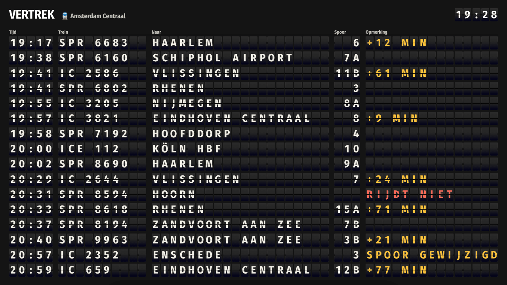
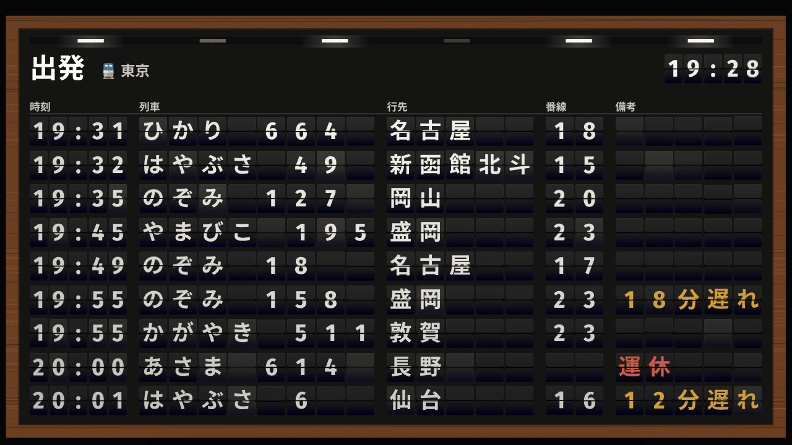
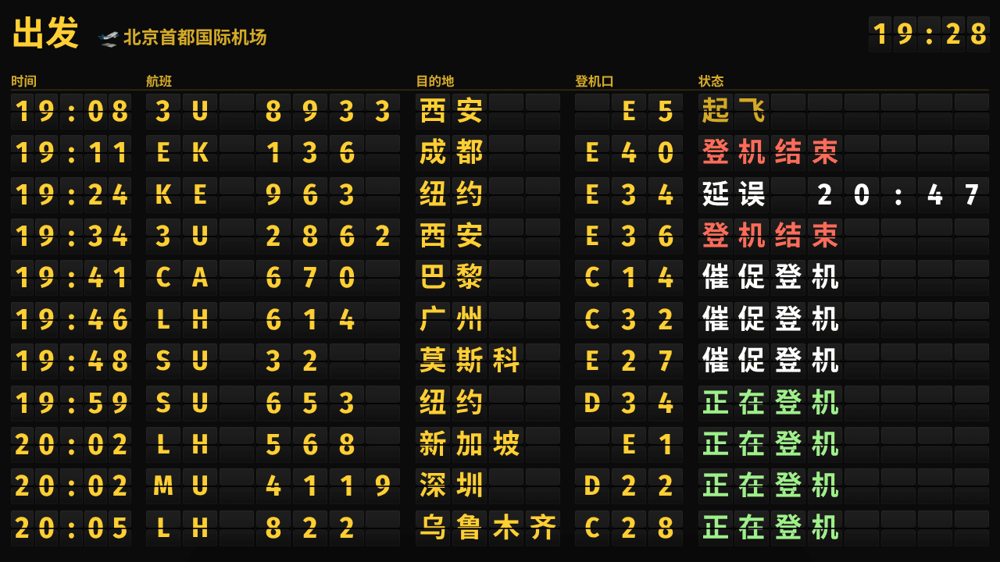
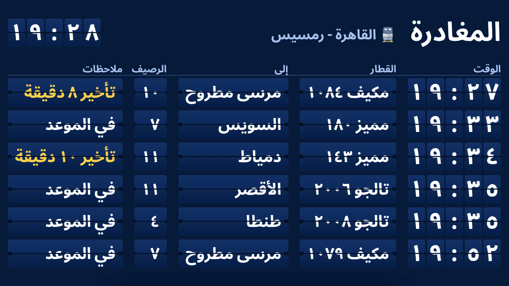
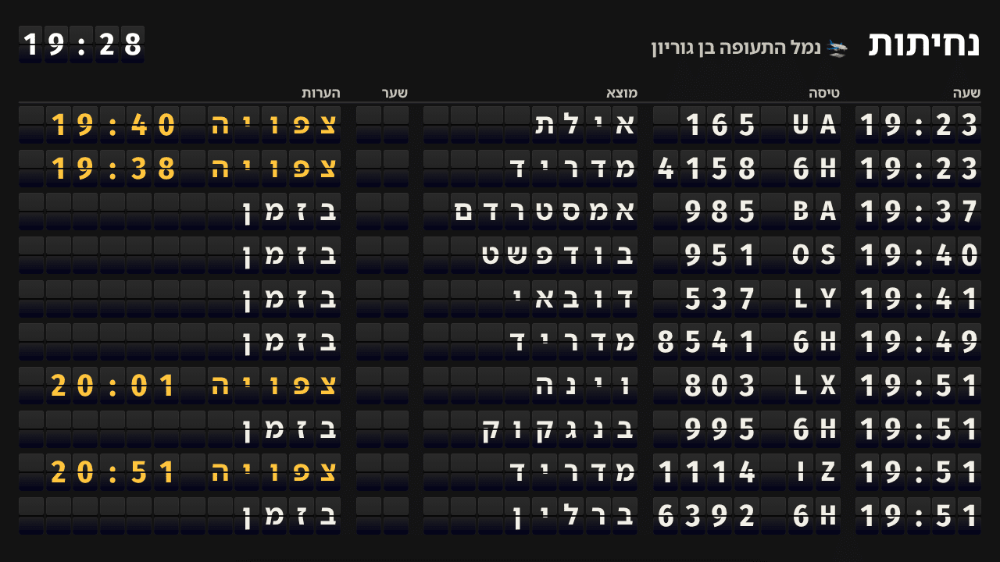
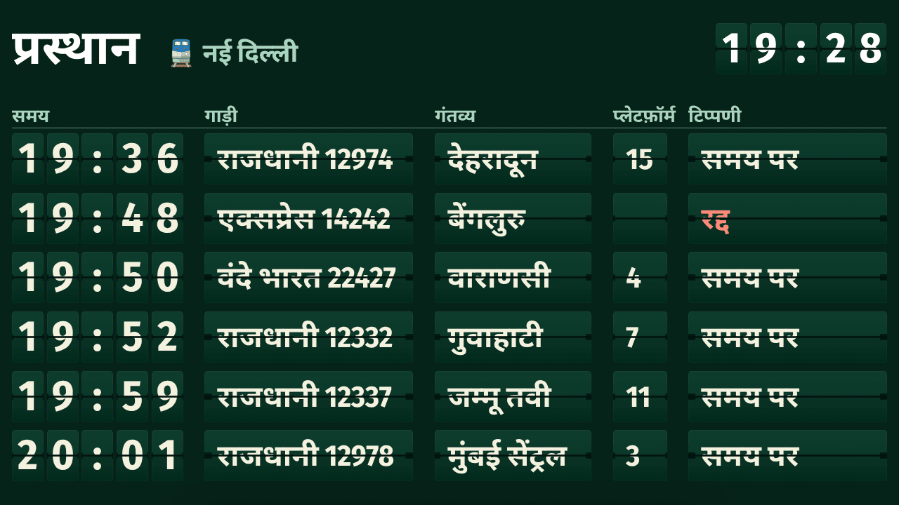
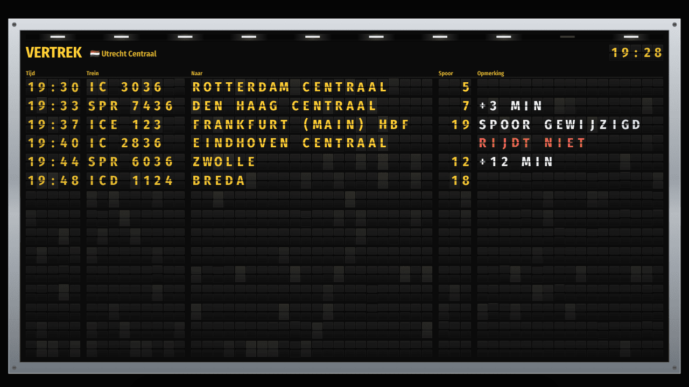
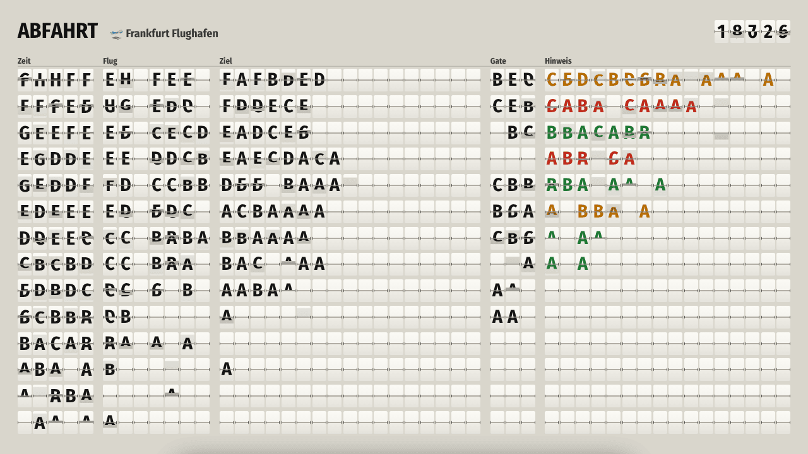
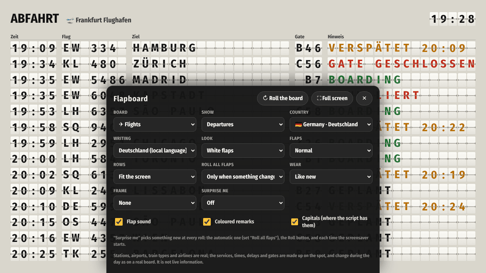
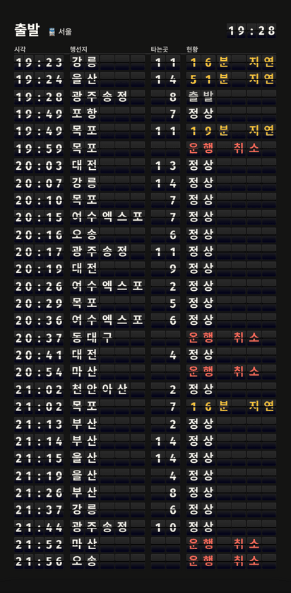

# Flapboard

A full-screen split-flap departure board (the clattering "Solari" board) for trains and flights, as an Android app and a single HTML page.

- Trains or flights, departures or arrivals, in 15 countries: Netherlands, Germany, France, United Kingdom, Italy, Spain, Russia, Greece, Israel, Egypt, India, Thailand, China, Japan, South Korea.
- Ten writing systems: Latin, Cyrillic, Greek, Hebrew (right to left), Arabic (right to left, Eastern Arabic digits), Devanagari, Thai, Chinese, Japanese and Korean.
  Letter-by-letter flaps where the script allows it; whole-word flaps for Arabic, Devanagari and Thai (whose letters join), like real boards in those countries.
- Local script, Latin letters/English, or alternating between the two.
- Looks: classic black, airport amber, station blue, green, white flaps. Flap speed, number of rows, capitals, coloured remarks, synthesised flap sound.
- **NS live**: real departures and arrivals for any Dutch station, with your own free NS API key (apiportal.ns.nl, product Ns-App). The Android app and the screensavers relay the requests (a plain browser page may not call NS directly).
- **Wear and frames**: a well-used board with tired flaps that hesitate, sun-faded tiles, uneven flaps, light falling from above and a lamp strip with a dead and a flickering lamp; frames in aluminium or wood.
- **Roll all flaps** every 10, 20 or 30 seconds up to every 30 minutes, and **Surprise me**: another country, look or everything (or another NS station) at every roll.
- Tap the board for the settings. The app keeps the screen on and runs full screen.

## Screenshots

| | |
|---|---|
|  |  |
| Tokyo station in Japanese, wooden frame, "well used" (tired flaps, a dead lamp) | Flights from Beijing in Chinese, airport amber |
|  |  |
| Cairo in Arabic: right to left, whole-word flaps, Eastern Arabic digits | Arrivals at Ben Gurion in Hebrew, letter by letter, right to left |
|  |  |
| New Delhi in Hindi (Devanagari), green | NS live at Utrecht Centraal, aluminium frame (made with test data) |
|  |  |
| Frankfurt Airport on white flaps, mid-roll | The settings: tap the board |

 Seoul station in Korean, on a phone held upright

Stations, airports, train types and airline codes are real. The services, times, delays, platforms and gates are generated for each day (the same for everyone on that day) and change as the day goes on: boarding, final call, departed, delays, cancellations. Apart from NS live, it is not live information.

## Screensavers

- **Windows** (`windows/`): `Flapboard.scr`, a small native program with the board built in. It shows the board full screen in Microsoft Edge (or Chrome) in kiosk mode with its own profile, blacks out other monitors and closes on mouse or keyboard input. "Settings..." opens the board with its settings in a window. Build: `python3 windows/make_board.py && zig cc -target x86_64-windows-gnu -O2 -municode -Wl,--subsystem,windows windows/flapsaver.c windows/board.c -o Flapboard.scr -luser32 -lshell32 -ladvapi32 -lgdi32` (zig from `pip install ziglang`).
- **Linux** (`linux/`): `flapboard-saver`, a Python script that watches the X11 idle time and shows the board in a browser in kiosk mode; `install.sh` sets it up for the current user with autostart and a settings entry in the menu.

Build: `npm install && pip install fonttools brotli && python3 build.py` → `dist/flapboard.html` and `android/assets/index.html`
(the fonts are cut down to the characters the boards use), then
`ANDROID_JAR=… KEYSTORE_FILE=… KEYSTORE_PASSWORD=… KEY_ALIAS=flapboard android/build.sh`.
